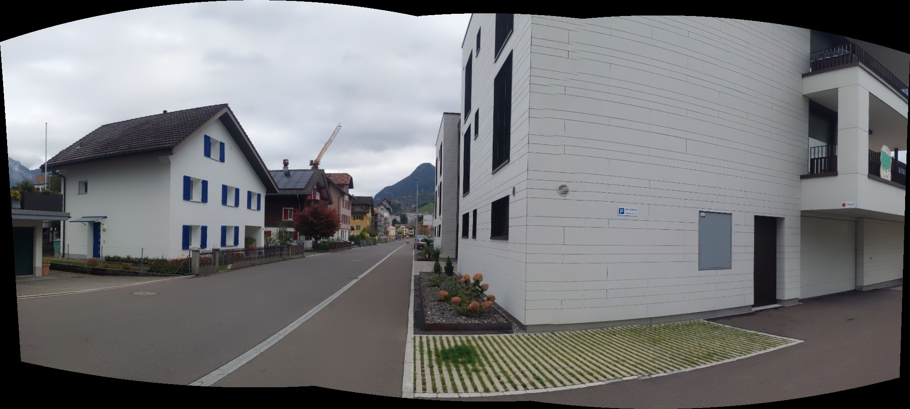
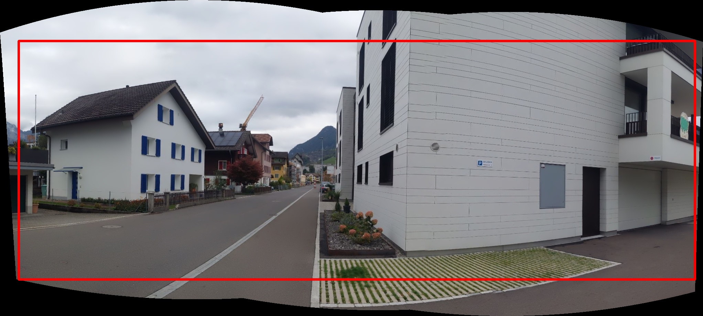
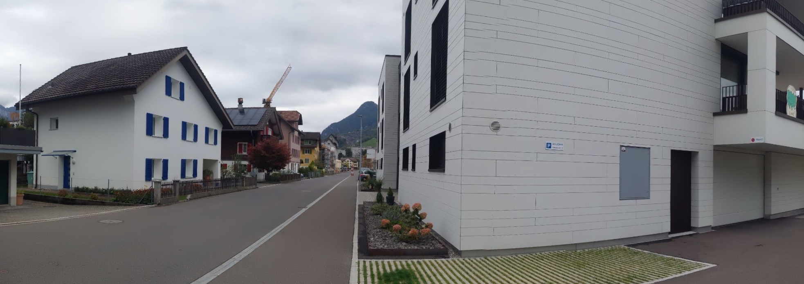

# Crop stitcher 
<a href="https://www.python.org"></a>
<a href="https://opensource.org/licenses/MIT"></a>

Crop the black borders off a stitched panorama, even when the panorama is **curved or skewed**.

OpenCV's stitcher (and most custom stitching pipelines) warp every input image onto a shared canvas. The result is rarely a clean rectangle: the outline bends, tilts or waves, and the gaps are filled with black. `crop_stitcher` finds the **largest axis-aligned rectangle that contains only real image pixels** and crops to it.

## Example

**1. Input**: stitched panorama with a curved, wavy outline and black borders



**2. Detected rectangle**: the largest rectangle that fits entirely inside the valid pixels, drawn in red



**3. Result**: the cropped panorama with no black borders



To reproduce this example:

```python
import cv2
from crop_stitcher import crop_stitcher

img = cv2.imread("examples/panorama.jpg")

cropped, (x, y, w, h) = crop_stitcher(img, black_thresh=5)
cv2.imwrite("panorama_cropped.jpg", cropped)

# Optional: draw the detected rectangle (like the second image above)
img_copy = img.copy()
img_copy = cv2.rectangle(img_copy, (x, y), (x + w - 1, y + h - 1), (0, 0, 255), 4)
cv2.imwrite("panorama_rect.jpg", img_copy)
```

> **Why `black_thresh=5`?** This example is a JPEG, so the "black" borders are not exactly `0`. Compression noise leaves values of a few levels near the edges. The default threshold of `1` is meant for lossless images (PNG, or straight from the stitcher). For JPEG inputs, use a value of about 5 to 10.

## Installation

```bash
pip install opencv-python numpy
```
Or with conda:

```bash
conda install -c conda-forge opencv numpy
```

Then copy `crop_stitcher.py` into your project.

## Usage

### As a function

```python
import cv2
from crop_stitcher import crop_stitcher

stitcher = cv2.Stitcher_create()
status, result = stitcher.stitch(images)

cropped, (x, y, w, h) = crop_stitcher(result)
cv2.imwrite("result_cropped.jpg", cropped)
```

### From the command line

```bash
python crop_stitcher.py input.jpg output.jpg
```

The command line uses the default parameters. For JPEG inputs, call the function from Python and set `black_thresh` (see above).

## API

```python
crop_stitcher(pano, black_thresh=1, max_dim=600, smooth_ksize=5, margin=0)
```

| Parameter | Default | Description |
|---|---|---|
| `pano` | – | Stitched image (BGR or grayscale `numpy` array). |
| `black_thresh` | `1` | Pixels with intensity below this value count as empty. Raise it for JPEGs or noisy borders. |
| `max_dim` | `600` | The rectangle search runs on a copy downscaled to this size, then maps back to full resolution. Larger is more precise but slower. |
| `smooth_ksize` | `5` | Kernel size for the morphological cleanup of the mask (removes specks and pinholes). |
| `margin` | `0` | Extra pixels trimmed from every side of the result. Useful for ragged blended edges. |

**Returns** `(cropped, (x, y, w, h))`: the cropped image and the rectangle in the original image's pixel coordinates. If no valid pixels are found, the original image is returned unchanged.

## How it works

1. Valid-pixel mask. Convert to grayscale and threshold at `black_thresh`.
2. Clean up. Morphological close and open remove pinholes and thin fringes. Only the largest connected region is kept, and its interior is filled.
3. Largest inscribed rectangle. On a downscaled mask, find the biggest axis-aligned rectangle containing only valid pixels. This uses the classic "maximal rectangle" method: build a per-row histogram of consecutive valid pixels, then find the largest rectangle in each histogram with a stack. It runs in O(height × width), so no iterative erosion is needed.
4. Scale back and verify. Map the rectangle to full resolution, then shrink it one pixel at a time until the full-resolution crop contains no empty pixels.

## Limitations and tips

- A rectangle can't follow a curve. With a strongly curved outline, the largest rectangle may discard a lot of the image. If that is too much, warp with a cylindrical or spherical projection before stitching, or fill the borders by inpainting instead of cropping.
- Real black content. Genuinely black areas inside the scene (a shadow, a dark object) are treated as empty if they touch the border region. Lower `black_thresh` or use the stitcher's own mask if this matters.
- Ragged edges. If blended seams look rough at the border of the crop, set `margin` to a few pixels.
- Speed. The search cost depends on `max_dim`, not on the image size, so very large panoramas are still cropped quickly.

## License

This project is licensed under the [MIT License](LICENSE).